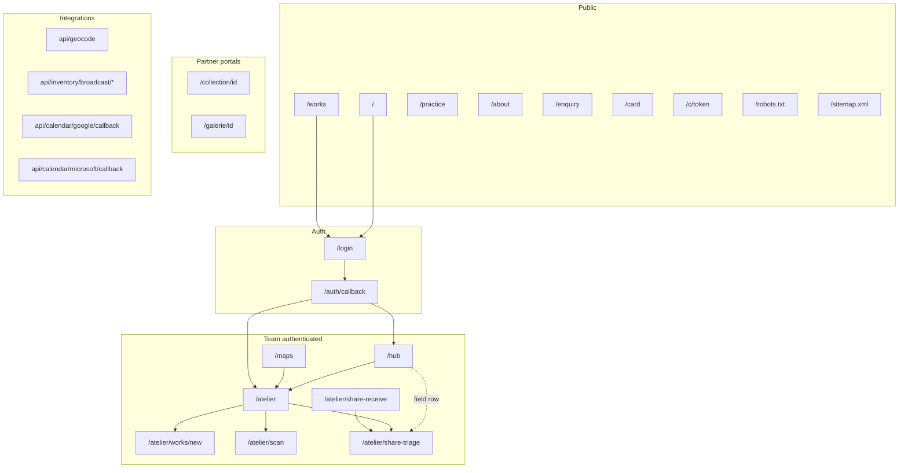
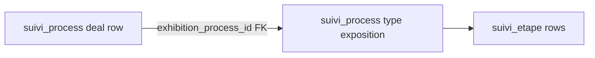

# PEM Hub — site map (authoritative routes & surfaces)

**Audience:** engineers and studio operators. **Diagrams:** Mermaid blocks below render on GitHub and most Markdown previews.

**Stack:** Next.js 15 App Router, Supabase auth, R2 (EU endpoint). **i18n:** FR/EN via [`defineMessages`](../lib/i18n/messages/) modules + legacy [`lib/i18n/dictionary/`](../lib/i18n/dictionary/); client `t()` uses [`resolveMessage`](../lib/i18n/resolve-message.ts). CI: `npm run i18n:check` ([`HANDOFF_SLICE4.md`](docs/archive/HANDOFF_SLICE4.md)).

---

## 0. Supabase / GitHub operator checklist (repo ships SQL — you apply in project)

| Step | Artifact | Notes |
|------|----------|--------|
| Dead schema drop | [`supabase/sql/dead_columns_drop.sql`](../supabase/sql/dead_columns_drop.sql) | Run in Supabase SQL Editor; then [`grant_audit_queries.sql`](../supabase/sql/grant_audit_queries.sql). Recreate any view dropped by `CASCADE` without removed columns. |
| Audit TTL + prune | [`supabase/sql/audit_log_ttl.sql`](../supabase/sql/audit_log_ttl.sql) | Defines `audit_log_prune()`. Run SQL once; smoke `select audit_log_prune();` |
| Weekly prune automation | [`.github/workflows/audit-prune.yml`](../.github/workflows/audit-prune.yml) | Requires repo secret `SUPABASE_DB_URL` (same pattern as backup). Enable after first manual prune succeeds. |
| Share inbox (share target / triage) | [`supabase/sql/share_inbox.sql`](../supabase/sql/share_inbox.sql) | Required for [`share-receive`](../app/atelier/share-receive/route.ts) inserts. |

---

## 1. Route index (App Router)

### Public (no login)

| Path | Purpose |
|------|---------|
| `/` | Landing: server `metadata` (indexable, OG/Twitter) in [`app/page.tsx`](../app/page.tsx); client shell in [`components/public/LandingPage.tsx`](../components/public/LandingPage.tsx) — orbits, language toggle, optional portfolio PDF modal, circadian sky (viewer's real sun/moon, see below) |
| `/works` | Public works / portfolio layout (collections from atelier config) |
| `/practice` | Artist practice / démarche |
| `/about` | Biography / CV |
| `/enquiry` | Visitor contact / enquiry (optional `?oeuvre_id=` / `?sale_order_id=` for after-sales routing) |
| `/verify/[certId]` | Certificate of authenticity verification (QR target; `SUPABASE_SERVICE_ROLE_KEY` required server-side) |
| `/card` | Printable business card sheet (`noindex`) |
| `/c/[token]` | Private selection link: validates `private_link` server-side, shows grouped works (`noindex`) |

### Auth

| Path | Purpose |
|------|---------|
| `/login` | Sign-in; `?next=` return path after success |
| `/login/reset-password` | Set a new password: from the emailed reset link (via `/auth/callback?next=`), or **Change password** for a signed-in email account. Sign out / Change password: [`AccountActions`](components/shared/AccountActions.tsx) in the Atelier header (desktop + phone drawer) and at the bottom of `/hub`; Change password hidden for Google-only accounts (`app_metadata.providers` without `email`); Sign out = `signOut()` + full load of `/login` |
| `/auth/callback` | Supabase OAuth callback |

### Team (login required — see middleware)

| Path | Purpose |
|------|---------|
| `/hub` | Executive dashboard: stats, feeds (`system_log` audit rows + `studio_task` suggestions), tiles into Atelier & public site |
| `/atelier` | Redirect hub: bare `/atelier` → `/atelier/overview`; legacy `?tab=<id>` → `/atelier/<id>` (other query params preserved, e.g. `?contact=`); `?map=<uuid>` → `/atelier/constellation?map=`; see §3 |
| `/atelier/overview` | **Slice 3B — Vue d’ensemble** (`routeTab=overview`); panel [`OverviewTab.tsx`](../components/atelier/overview/OverviewTab.tsx) |
| `/atelier/map` | **Slice 3B — Carte** (`routeTab=map`; sidebar Commercial since 2026-11-02); [`WorldMapTab.tsx`](../components/atelier/WorldMapTab.tsx) |
| `/atelier/journal` | **Main field tab** (owner 2026-11-12): Hub → `?today=1` opens today, `?day=YYYY-MM-DD` opens that day (⌘K journal hits, Constellation panel); day page = quick row ✍️ Écrire · 🎙 Dicter · 🎤 Note vocale (`VoiceNoteSheet`) · 📷 Capture (admin), entries, **Œuvres du jour** with the field-session form embedded (`SessionNewClient embed`, loads only when opened), then folded Création / voice notes / works changed. Was **Slice 3B — Journal sessions** (`routeTab=journal`); [`SessionJournalTab.tsx`](../components/atelier/SessionJournalTab.tsx). Index = field-session days + days with entries, Kaizen Création items or voice notes + today (**Écrire aujourd'hui**). Day page has **Entrées du jour** (`journal_entry`, append-only, team; `#1234` links works), the day's Kaizen **Création** items (read from `kaizen_item`, not copied), voice notes, and works changed (admins); empty sections say so. Phone: list **or** day full screen (`← Jours`); entry form has 🎙 dictation (Web Speech → provenance `voice`, unverified) and a concept picker; entries render light Markdown ([`EntryText.tsx`](../components/atelier/journal/EntryText.tsx), display only); AI link suggestions ✦ (admin Valider / Rejeter, `decideJournalLink`) — [`JournalDayExtras.tsx`](../components/atelier/journal/JournalDayExtras.tsx), actions [`journal/entry-actions.ts`](../app/atelier/(portal)/journal/entry-actions.ts) (2026-11-12) |
| `/atelier/kaizen-ops` | Kaizen → **Opérations & Stratégie** (`routeTab=kaizen-ops`, 2026-11-02): Système / Business pills + À valider; `/atelier/kaizen` = **Création**; old `/atelier/kaizen?view=website|business|system|review` forwards here. Sidebar badges from `kaizenUnseenCounts` / `markKaizenSeen` (`kaizen_seen`) |
| `/atelier/system` | Redirects to `/atelier/kaizen-ops?view=website` (2026-11-02): Kaizen → Opérations & Stratégie → **Système** (section `website`, renamed) = app/site entries + the site tools ([`SystemTab.tsx`](../components/atelier/SystemTab.tsx) `embedded` renders the tools only) |
| `/atelier/portfolio` | **Slice 3B — Portfolio config** (`routeTab=portfolio`); [`PortfolioConfigShell.tsx`](../components/atelier/PortfolioConfigShell.tsx) |
| `/atelier/site` | **Slice 3B — Site public** (`routeTab=site`); same shell as portfolio |
| `/atelier/analytics` | **Slice 3B — Analytics** (`routeTab=analytics`); same shell as portfolio |
| `/atelier/kaizen` | **Kaizen** (`routeTab=kaizen`, owner 2026-11-02): ideas and improvements — Création / Opérations & Stratégie (Site web, Business), `?view=creation|website|business|review`; [`Kaizen.tsx`](../app/atelier/(portal)/kaizen/_components/Kaizen.tsx), actions [`kaizen/actions.ts`](../app/atelier/(portal)/kaizen/actions.ts), table `kaizen_item` ([`kaizen.sql`](../supabase/sql/kaizen.sql)): ticked done / reopened, never deleted (no DELETE grant); **Nouveautés 3.0** panel (`?whatsnew=1`, [`WhatsNew.tsx`](../components/atelier/WhatsNew.tsx), items [`lib/whats-new.ts`](../lib/whats-new.ts) — the same list is the Atelier's "www.thepemworkshop.com 3.0" popup until "Ne plus afficher"); up to 6 **screenshots** per entry (`kaizen_item.screenshots`, [`KaizenScreenshots.tsx`](../app/atelier/(portal)/kaizen/_components/KaizenScreenshots.tsx), `addKaizenScreenshot` / `removeKaizenScreenshot`, R2 `kaizen/…`, 2026-11-03). Sidebar: alone at the top (desktop), right after Terrain (phone). System ledger hides rows moved here (`system_log.metadata.kaizen_id`); Overview "Kaizen à trier / ouvert" counts entries to sort + open Site web / Business |
| `/atelier/contacts` | **Slice 3B — Contacts** (`routeTab=contacts`; sidebar Commercial since 2026-11-02); [`ContactsTab.tsx`](../components/atelier/ContactsTab.tsx); `?contact=<id>` opens editor then strips param. From a work drawer, ↗ on a contact opens the same editor in a pop-up over the drawer ([`ContactQuickModal.tsx`](components/atelier/work-drawer/ContactQuickModal.tsx), Kaizen #34) — no navigation |
| `/atelier/stock` | **Fournitures / Supplies** (Studio group, `routeTab=stock`): [`SuppliesTab.tsx`](../components/atelier/supplies/SuppliesTab.tsx) with `?view=` **stock** ([`SupplierHub.tsx`](../components/atelier/SupplierHub.tsx)) · **count** (`StockTake`) · **restock** ([`SuppliesRestock.tsx`](../components/atelier/supplies/SuppliesRestock.tsx): out of stock / below minimum, grouped by supplier, order draft per device, copy order) |
| `/atelier/inventory` | **Slice 3 — Inventaire tab** (segment route): same shell as `/atelier` with `routeTab=inventory`; panel in [`Inventory.tsx`](../app/atelier/inventory/_components/Inventory.tsx); canonical URL for field inventory on phone |
| `/atelier/sales` | **Slice 3 — Ventes tab** (segment route): `routeTab=sales`; panel in [`Sales.tsx`](../app/atelier/sales/_components/Sales.tsx); server actions remain [`app/atelier/sales/actions.ts`](../app/atelier/sales/actions.ts) |
| `/atelier/pipeline` | **Slice 3 — Pipeline tab** (segment route): `routeTab=pipeline`; panel in [`Pipeline.tsx`](../app/atelier/pipeline/_components/Pipeline.tsx); server actions remain [`app/atelier/pipeline/actions.ts`](../app/atelier/pipeline/actions.ts) |
| `/atelier/production` | **Slice 3 — Production tab** (segment route): `routeTab=production`; panel in [`Production.tsx`](../app/atelier/production/_components/Production.tsx) |
| `/atelier/stock-take` | Redirects to `/atelier/stock?view=count` (Stock-take moved into **Fournitures → Comptage**, 2026-11-02); panel [`StockTake.tsx`](../app/atelier/(portal)/stock-take/_components/StockTake.tsx) |
| `/atelier/notes` | **Slice 3 — Notes tab** (segment route): `routeTab=notes`; panel in [`Notes.tsx`](../app/atelier/notes/_components/Notes.tsx); server actions [`app/atelier/notes/actions.ts`](../app/atelier/notes/actions.ts) |
| `/atelier/reports` | **Slice 3 — Rapports tab** (segment route): `routeTab=reports`; panel in [`Reports.tsx`](../app/atelier/reports/_components/Reports.tsx); PDF export [`app/atelier/reports/actions.ts`](../app/atelier/reports/actions.ts) |
| `/atelier/exhibitions` | **Slice 3 — Expositions tab** (segment route): `routeTab=exhibitions`; panel in [`Exhibitions.tsx`](../app/atelier/exhibitions/_components/Exhibitions.tsx); own `suivi_process` fetch + calendar OAuth return; server actions [`app/atelier/exhibitions/actions.ts`](../app/atelier/exhibitions/actions.ts) |
| `/atelier/concepts` | **Slice 3 — Concepts tab, labelled "Recherche" / "Research"** since 2026-11-01 (nav key `concepts`; route and code names unchanged) (segment route): `routeTab=concepts`; panel in [`Concepts.tsx`](../app/atelier/concepts/_components/Concepts.tsx); server actions [`app/atelier/concepts/actions.ts`](../app/atelier/concepts/actions.ts). **Documents per concept** ([`ConceptDocuments.tsx`](components/atelier/concepts/ConceptDocuments.tsx), actions [`concepts/document-actions.ts`](app/atelier/(portal)/concepts/document-actions.ts)): Vault `document` rows with `concept_id`, three kinds via `document.source` — `file` (R2 `vault` bucket; ≤4 MB via `uploadDocument`, larger via `createVaultUploadUrl` + `finalizeVaultUpload`, max 50 MB), `link` (`external_url`, Drive/Proton/web), `local` (`local_location`, plain-text "machine — path", copy only). Schema: [`document_concept_links.sql`](supabase/sql/document_concept_links.sql) |
| `/atelier/themes` | **Slice 3 — Thèmes tab** (segment route): `routeTab=themes`; panel in [`Themes.tsx`](../app/atelier/themes/_components/Themes.tsx) |
| `/atelier/logistics` | **Slice 3 — Logistique tab** (segment route): `routeTab=logistics`; panel in [`Logistics.tsx`](../app/atelier/logistics/_components/Logistics.tsx); server actions [`app/atelier/logistics/actions.ts`](../app/atelier/logistics/actions.ts) |
| `/atelier/vault` | **Slice 3 — Coffre tab** (segment route): `routeTab=vault`; panel in [`Vault.tsx`](../app/atelier/vault/_components/Vault.tsx); server actions [`app/atelier/vault/actions.ts`](../app/atelier/vault/actions.ts) |
| `/atelier/fiscal` | **Slice 3 — Revenus & Dépenses tab** (segment route): `routeTab=fiscal`; panel in [`Fiscal.tsx`](../app/atelier/fiscal/_components/Fiscal.tsx); client-side `expense` fetch + French BNC tax framework; **Par année** sub-tab ([`FiscalByYear.tsx`](../app/atelier/(portal)/fiscal/_components/FiscalByYear.tsx), income via `fetchIncomeEntries` in [`lib/sales/income.ts`](../lib/sales/income.ts)): per-year income / expenses / net, year to date vs last year, pivot (2026-11-03) |
| `/atelier/broadcast` | **Slice 3 — Diffusion tab** (segment route): `routeTab=broadcast`; admin-only panel in [`Broadcast.tsx`](../app/atelier/broadcast/_components/Broadcast.tsx); server actions [`app/atelier/broadcast/actions.ts`](../app/atelier/broadcast/actions.ts) |
| `/atelier/audit` | **Slice 3 — Audit tab** (segment route): `routeTab=audit`; admin-only ledger + pending review in [`Audit.tsx`](../app/atelier/audit/_components/Audit.tsx); server actions under [`app/atelier/audit/`](../app/atelier/audit/) |
| `/atelier/constellation` | **Slice 3 — Constellation tab** (segment route): `routeTab=constellation`; thin wrapper [`Constellation.tsx`](../app/atelier/constellation/_components/Constellation.tsx) → [`ConstellationCanvas.tsx`](../components/atelier/ConstellationCanvas.tsx); cloud maps + `?map=<uuid>` deep link; server actions [`app/atelier/constellation/actions.ts`](../app/atelier/constellation/actions.ts) |
| `/atelier/works/new` | Create work (`WorkForm`) |
| `/atelier/works/[id]` | QR label / "Copy link" target ([`work-physical-bridge-url.ts`](../lib/atelier/work-physical-bridge-url.ts)); redirects to `/atelier?work=<id>` (drawer). Added 2026-11-03 (was a 404) |
| `/atelier/works/[id]/edit` | Redirects to `/atelier?work=<id>` (drawer) |
| `/atelier/scan` | Mobile scan / manual ID → open work drawer |
| `/atelier/share-receive` | **POST** `multipart/form-data` — PWA **Web Share Target** or browser form from share triage (`files` optional; `title` / `text` / `url` optional). Persists to `share_inbox` + R2, **303** to triage. **GET** → redirect share triage ([`app/atelier/share-receive/route.ts`](../app/atelier/share-receive/route.ts); requires [`supabase/sql/share_inbox.sql`](../supabase/sql/share_inbox.sql)) |
| `/atelier/share-triage` | Lists `share_inbox` rows; detail view + **device import** form (files / title / text / URL) for iOS and parity with share target ([`app/atelier/share-triage/page.tsx`](../app/atelier/share-triage/page.tsx), [`ShareTriageClient.tsx`](../components/atelier/ShareTriageClient.tsx)) |
| `/atelier/session/new` | **Verb 1 — field session:** photo-first painting panel (picture → title → dimensions → support → technique → notes) committed by a **single** button; multi-shot staging, optional `?work=<id>` pre-link, optional **location + weather** snapshot (`lib/field-context.ts` → [`GET /api/field-weather`](../app/api/field-weather/route.ts) Open-Meteo proxy), `work_session` draft → submit (`pending_review`) or admin apply → `tblImage` via [`SessionNewClient`](../components/atelier/session/SessionNewClient.tsx) + [`app/atelier/session/actions.ts`](../app/atelier/session/actions.ts). New works carry `Technique`/`Support` from the field. Applied photos are visible and removable per painting (`removeAppliedSessionImage` → admin `deleteWorkImage`, R2 soft-delete to `recycle/`); a committed painting is review-only and links out to the work form for field edits. Requires [`supabase/sql/work_session.sql`](../supabase/sql/work_session.sql); empty-slot cleanup in [`work_session_prune_empty_items.sql`](../supabase/sql/work_session_prune_empty_items.sql) |
| `/atelier/capture` | Field **capture** — no/unrecognized `mode` → redirect `/hub`; `?mode=doc` multi-page scan → vault PDF; `?mode=card` business card photo + paste → preview → contact ([`CaptureCardClient`](../components/atelier/capture/CaptureCardClient.tsx)) |
| `/atelier/documents/new` | Ring C **documents** — stub + links (`kind="documents"`) until COA / paperwork flow ships |
| `/atelier/issue/new` | Ring C **issue** — maintenance report form → `studio_task` ([`IssueNewForm`](../components/atelier/IssueNewForm.tsx), [`field/actions`](../app/atelier/field/actions.ts)) |
| `/atelier/triage` | Ring C **broadcast triage** — stub + links (`kind="triage"`) distinct from **share-triage** |
| `/maps` | Index of saved constellation maps → open in Atelier (`noindex`) |

### Partner portals (login + row-level checks in page)

| Path | Purpose |
|------|---------|
| `/collection/[collector_id]` | Collector: `Contact.auth_user_id` + `ContactID`; lists works with `AcheteurID` |
| `/galerie/[gallery_id]` | Gallery partner: `Role === 'gallery'`; active consignment works |

### Static / generated metadata

| Path | Purpose |
|------|---------|
| `/robots.txt` | [`app/robots.ts`](../app/robots.ts) — allow `/`; disallow atelier, hub, galerie, collection, maps, login, card, `c/`, `api/`, `auth`, `_next`; points to `sitemap.xml` |
| `/sitemap.xml` | [`app/sitemap.ts`](../app/sitemap.ts) — indexable public URLs: `/`, `/works`, `/about`, `/practice`, `/enquiry` |
| `/Atelier_Studio_Bible.pdf` | Redirects to short-lived signed URL for latest `document.kind = 'bible'` in vault |
| `/manifest.webmanifest` | Next route [`app/manifest.ts`](../app/manifest.ts): `start_url` `/hub`, icons, **`share_target`** POST → [`/atelier/share-receive`](../app/atelier/share-receive/route.ts) (same field names as that handler: `title`, `text`, `url`, file parts). Static copy: [`public/manifest.webmanifest`](../public/manifest.webmanifest) — keep in sync when editing manifest fields. |
| Apple touch (iOS home screen) | [`app/layout.tsx`](../app/layout.tsx) — `link rel="apple-touch-icon"` → **`/pwa-icon-180.png`** (180×180 PNG; generated from `pwa-icon-192.png` via Sharp). Manifest icons stay 192 / 512 in `app/manifest.ts`. |

---

## 2. Middleware & layouts

**Session refresh:** [`middleware.ts`](../middleware.ts) runs Supabase cookie refresh on navigations (skips RSC/Flight).

**Document redirect to login** when unauthenticated and path matches:

- `/atelier`, `/hub`, `/galerie`, `/collection`, `/maps` (and subpaths)

**Layouts:** [`app/atelier/layout.tsx`](../app/atelier/layout.tsx), [`app/hub/layout.tsx`](../app/hub/layout.tsx), [`app/collection/layout.tsx`](../app/collection/layout.tsx), [`app/galerie/layout.tsx`](../app/galerie/layout.tsx) — team shell / portal chrome as applicable.

---

## 3. Atelier — tabs and deep links

Orchestrator: [`components/atelier/TeamPortalClient.tsx`](../components/atelier/TeamPortalClient.tsx).

**RSC data spine (`app/atelier/page.tsx`, segmented tab `page.tsx` routes):** shared loader [`loadAtelierShellProps`](../lib/atelier/load-atelier-shell-props.ts) — exact `Oeuvres` count + **first keyset chunk** only; reference tables are **empty sentinels** on first paint and hydrate in one client-triggered server round-trip via [`fetchAtelierShellPostPaint`](../app/atelier/atelier-data-actions.ts) (contacts, `contact_addresses`, techniques, themes, `OeuvreStatus`, groups, presentations). `TeamPortalClient` runs that action when `atelierShellNonce` changes after navigation/refresh. Tab navigation uses [`atelierTabHref`](../lib/atelier/tab-routes.ts) for all **25** segmented tabs (Slice 3 + 3B — see route table §2 and [`tab-routes.ts`](../lib/atelier/tab-routes.ts)). Legacy `?tab=` on `/atelier` still redirects for bookmarks. `exhibition` rows are **not** loaded here — [`Exhibitions.tsx`](../app/atelier/exhibitions/_components/Exhibitions.tsx) fetches its own `suivi_process` list. The **Carte** tab ([`WorldMapTab.tsx`](../components/atelier/WorldMapTab.tsx)) performs its **own** anon `contact_addresses` read for map pins. Unread `suivi_reminder` rows are passed as `initialReminders` from [`listUnreadSuiviReminders`](../app/atelier/reminders-actions.ts); mutations revalidate via `revalidateRemindersTag()` + `router.refresh()`.

**Partial catalogue (loaded œuvres fewer than DB total):** [`TeamPortalClient.tsx`](../components/atelier/TeamPortalClient.tsx) shows a top **subset** strip (`data-testid="atelier-oeuvres-subset-banner"`, optional second **Load next batch** control), keeps the bottom paging bar (`data-testid="atelier-oeuvres-paging-bar"`), and passes `oeuvresPaging.totalCount` into tabs so list/pivot/overview numbers are not mistaken for the full catalogue. Overview adds `data-testid="atelier-overview-subset-caption"`; **Rapports** adds `data-testid="reports-subset-note"`; **Thèmes** / **Portfolio** add `data-testid="atelier-themes-subset-note"` / `data-testid="atelier-portfolio-subset-note"`. Playwright: [`tests/atelier-oeuvres-paging-bar.spec.ts`](../tests/atelier-oeuvres-paging-bar.spec.ts), [`tests/reports-tab.spec.ts`](../tests/reports-tab.spec.ts) (subset note when partial).

### Atelier bootstrap server modules (not HTTP routes)

| Module | Role |
|--------|------|
| [`app/atelier/reminders-actions.ts`](../app/atelier/reminders-actions.ts) | `getUnreadReminderCountCached`, `listUnreadSuiviReminders`, `markSuiviReminderRead`, `insertSuiviReminder`, `revalidateRemindersTag` — RSC + client-refresh path for `suivi_reminder` |
| [`lib/atelier/load-atelier-shell-props.ts`](../lib/atelier/load-atelier-shell-props.ts) | **`loadAtelierShellProps`** — shared RSC props for `/atelier` and segmented tab routes |
| [`lib/atelier/tab-routes.ts`](../lib/atelier/tab-routes.ts) | **`atelierTabHref`**, legacy `?tab=inventory|sales|pipeline|production|stock-take|notes|reports|exhibitions|concepts|themes|logistics|vault|fiscal|broadcast|audit|constellation` → segment route redirects |
| [`app/atelier/atelier-data-actions.ts`](../app/atelier/atelier-data-actions.ts) | **`fetchAtelierShellPostPaint`** — post–first-paint bundle: contacts, `contact_addresses`, reference tables for the shell; `fetchAtelierContacts` / `fetchAtelierContactAddresses` are thin deprecated wrappers |
| [`app/atelier/system/ledger-attachment-actions.ts`](../app/atelier/system/ledger-attachment-actions.ts) | `uploadLedgerAttachment` — team-gated R2 upload for System Ledger screenshots (`ledger/*` keys; metadata in `system_log.attachments`) |
| [`app/atelier/system/actions.ts`](../app/atelier/system/actions.ts) | `deleteStudioTask` — admin-only delete on `studio_task` (Hub “pulse” task list) |
| [`app/atelier/reports/actions.ts`](../app/atelier/reports/actions.ts) | `generateTablePdf` — pdfkit export of the table a report shows (any source) |

These are **`'use server'`** modules (callable from Server Components and from the client after hydration), distinct from `app/api/**` route handlers. Domain **writes** for works, contacts, etc. remain in `app/**/actions.ts` per CLAUDE.md.

### Query string contract

| Param | Behavior |
|-------|----------|
| `?tab=<Tab>` | Opens tab (`Tab` union in `TeamPortalClient`; persisted in `localStorage` as `pem_team_tab`). **`?tab=inventory`** / **`?tab=sales`** / **`?tab=pipeline`** / **`?tab=production`** / **`?tab=stock-take`** / **`?tab=notes`** / **`?tab=reports`** / **`?tab=exhibitions`** / **`?tab=concepts`** / **`?tab=themes`** / **`?tab=logistics`** / **`?tab=vault`** / **`?tab=fiscal`** / **`?tab=broadcast`** / **`?tab=audit`** / **`?tab=constellation`** → server redirect to segment routes (other query params preserved) |
| `?work=<OeuvreID>` | Opens **WorkDrawer** for work after load; stripped from URL after open |
| `?map=<uuid>` | Constellation tab loads cloud map via `loadConstellationMap`; canonical URL `/atelier/constellation?map=`; bare `/atelier?map=` redirects to segment route; param stripped after load |
| `?exhibition=<processId>` | Exhibitions tab selects that `suivi_process` id (see [`Exhibitions.tsx`](../app/atelier/exhibitions/_components/Exhibitions.tsx); route `/atelier/exhibitions`) |
| `?calendar=google_ok` / `microsoft_ok` / `*_err` | OAuth return banner in Exhibitions; params cleaned from URL |

### Tab list (desktop group order)

**Terrain / Field (narrow sidebar first):** `inventory`, `production`, `journal`, `notes`, `map` (supplies count → Studio · Fournitures) — then Kaizen (Audit for admins first, Création, Opérations & Stratégie), Studio, Catalogue, Commercial, Public groups (`TeamPortalClient` `GROUPS`); no Admin group since 2026-11-12.

**Full tab ids:** `overview`, `inventory`, `reports`, `constellation`, `production`, `logistics`, `sales`, `exhibitions`, `vault`, `contacts`, `map`, `pipeline`, `fiscal`, `concepts`, `themes`, `stock`, `stock-take`, `notes`, `system`, `portfolio`, `audit` (admin), `broadcast` (admin).

### Major client surfaces

- **Inventory** — [`app/atelier/inventory/_components/Inventory.tsx`](../app/atelier/inventory/_components/Inventory.tsx) (`/atelier/inventory`): list / grid / pivot (phone: own saved view, default grid; controls behind one **Filtres & vues** button); virtual scroll; embedded WorkDrawer preview; desktop toolbar **Images ZIP** downloads the current filter's images via [`SelectionImagesDownloadModal`](../components/atelier/SelectionImagesDownloadModal.tsx) → `POST /api/export/work-images` in numbered batches of ≤100 works (same modal as the Curation dock). **Couleurs** panel ([`ColourFilterPanel.tsx`](../app/atelier/(portal)/inventory/_components/ColourFilterPanel.tsx)): colour-wheel families with / without, nearby shades, coverage or monochrome-first ranking over the whole catalogue's cover palettes; drawer palette legend opens it on one family. **Périodes** panel ([`PeriodSourceManager.tsx`](../components/atelier/PeriodSourceManager.tsx)) edits periods + source values; Période / Source filters, Période column, pivot dims ([`lib/work-periods.ts`](../lib/work-periods.ts)). Playwright: [`tests/inventory-virtual.spec.ts`](../tests/inventory-virtual.spec.ts), [`tests/atelier-oeuvres-paging-bar.spec.ts`](../tests/atelier-oeuvres-paging-bar.spec.ts).
- **WorkDrawer** — phone (<768px) opens in **field mode**: image, title, Identity (technique, support, size…), comments/history; status, pipeline, period, QR, finance, cost, voice notes, constats, groups, sessions folded under **Tous les champs** (`DrawerContent` `allFields`, 2026-11-12). Canonical edit: shell in [`WorkDrawer.tsx`](../components/atelier/WorkDrawer.tsx); inner panels under [`components/atelier/work-drawer/`](../components/atelier/work-drawer/) (`DrawerContent`, pipeline, finance, notes/version, groups, images, **Constats** `ConditionReportsSection` (condition reports + issues/photos; kind Examen / Destruction / Perte sets Destroyed / Lost, `supabase/sql/condition_report_fate.sql`; `app/atelier/works/condition-actions.ts`), **Période & source** `WorkPeriodSourceSection` (`app/atelier/works/period-source-actions.ts`), `drawer-widgets`, `drawer-content-utils`).
- **Reports** — [`Reports.tsx`](../app/atelier/reports/_components/Reports.tsx) (`/atelier/reports`): Access-style reports: **source** tabs Œuvres / Production / Kaizen / Ventes / Contacts (`?source=` from each section's **Rapport** button), **Champs** panel (tick, order, filter any field), optional pivot, saved reports (`saved_report`); Print, XLSX, CSV + PDF (`generateTablePdf`). Works-based sources use the currently loaded œuvres batch (`generateWorksTablePdf` in [`reports/actions.ts`](../app/atelier/reports/actions.ts)); column model in [`lib/reports/works-table.ts`](../lib/reports/works-table.ts). Playwright: [`tests/reports-tab.spec.ts`](../tests/reports-tab.spec.ts).
- **Exhibitions** — [`Exhibitions.tsx`](../app/atelier/exhibitions/_components/Exhibitions.tsx) (`/atelier/exhibitions`): exposition processes, steps, floor plan, calendar export; fetches `suivi_process` client-side. Playwright: [`tests/exhibitions-tab.spec.ts`](../tests/exhibitions-tab.spec.ts).
- **Concepts** — [`Concepts.tsx`](../app/atelier/concepts/_components/Concepts.tsx) (`/atelier/concepts`): idea bank before works; filters, sketch upload; fetches `concept` client-side via [`app/atelier/concepts/actions.ts`](../app/atelier/concepts/actions.ts). Playwright: [`tests/hub-mobile-capture.spec.ts`](../tests/hub-mobile-capture.spec.ts) (narrow overflow).
- **Themes** — [`Themes.tsx`](../app/atelier/themes/_components/Themes.tsx) (`/atelier/themes`): catalogue themes + working groups, mosaic preview, analytics panel; context-menu rename / ctrl+delete. Playwright: [`tests/themes-groups-contextmenu.spec.ts`](../tests/themes-groups-contextmenu.spec.ts).
- **Logistics** — [`Logistics.tsx`](../app/atelier/logistics/_components/Logistics.tsx) (`/atelier/logistics`): shipments table (upcoming + history); client-side fetch; mark delivered via [`app/atelier/logistics/actions.ts`](../app/atelier/logistics/actions.ts). Playwright: [`tests/atelier-logistics-tab.spec.ts`](../tests/atelier-logistics-tab.spec.ts).
- **Vault** — [`Vault.tsx`](../app/atelier/vault/_components/Vault.tsx) (`/atelier/vault`): documents; upload, preview, search/filter, COA generation; **Types** filter lists that type's files from every folder (folder shown per row), built-in types then custom ones (e.g. `CV`); Overview count excludes `.keep` folder markers; **Studio Bible download** button (moved from the Atelier header 2026-11-03); bible regeneration from Kaizen → Système (`vaultStudioBible`). Playwright: [`tests/atelier-vault-tab.spec.ts`](../tests/atelier-vault-tab.spec.ts).
- **Fiscal** — [`Fiscal.tsx`](../app/atelier/fiscal/_components/Fiscal.tsx) (`/atelier/fiscal`): expenses tracker, French BNC tax framework, pivot on `expense` rows; recettes from sold œuvres. Playwright: [`tests/atelier-fiscal-tab.spec.ts`](../tests/atelier-fiscal-tab.spec.ts).
- **WorldMapTab** — [`WorldMapTab.tsx`](../components/atelier/WorldMapTab.tsx) (`?tab=map`): Leaflet map; contacts vs œuvres mode; geocode via [`app/api/geocode/route.ts`](../app/api/geocode/route.ts) with client-side cache. Contact pins prefer `contact_addresses` rows with city/country, else **`Contact` card** `Ville`/`Pays` when no geocodable address row exists.
- **Notes** — [`Notes.tsx`](../app/atelier/notes/_components/Notes.tsx) (`/atelier/notes`): chronological voice notes (`public.voice_note`); filters, transcript edit, delete, optional `<audio>` via `imageUrl` + public R2. Capture: [`VoiceNoteSheet`](../components/shared/VoiceNoteSheet.tsx) + [`app/atelier/notes/actions.ts`](../app/atelier/notes/actions.ts). Work link optional (notes can be general). **Trier** panel ([`NoteTriagePanel.tsx`](../app/atelier/(portal)/notes/_components/NoteTriagePanel.tsx)): link to a Recherche concept / work / Pipeline project or an opt-in dated reminder (`voice_note.concept_id`, `routed_at`; "À trier (n)" filter); `?note=<id>` opens a note; linked notes listed on concept cards, work drawer, Pipeline project drawer ([`LinkedVoiceNotes.tsx`](../components/atelier/LinkedVoiceNotes.tsx)). Next-action follow-up → `suivi_reminder` (no `process_id`) → Hub inbox reminder cards + Pipeline reminders panel (✕ dismiss); not `studio_task`, which stays for material issue reports in Production. Playwright: [`tests/voice-notes.spec.ts`](../tests/voice-notes.spec.ts).
- **WorkForm** — create-only at `/atelier/works/new`.
- **See again** — [`SeeAgainCard.tsx`](components/atelier/SeeAgainCard.tsx) + [`see-again/actions.ts`](app/atelier/see-again/actions.ts): top of the Journal today page (under the quick row) and Overview right column. Three seeded picks a day (seed = Paris date): an entry from this week of an earlier year (else one 30+ days old), a work with no journal link and no hand-made relation, a close pair by embedding (`match_nodes`, service role) with no relation. Link = `tblrelations` `proximity` (via `insertConstellationRelation`); Not related / Don't show again = `see_again_dismissed` (own rows); Write about it = journal form with `#id` (event on the journal page, `?write=` from Overview). No AI text.
- **SystemTab** — [`SystemTab.tsx`](../components/atelier/SystemTab.tsx): manual **`system_log`** ledger (`event_type` null), optional **`attachments`** (R2 `ledger/*` via [`ledger-attachment-actions.ts`](../app/atelier/system/ledger-attachment-actions.ts)); embedded in Kaizen → Opérations & Stratégie → Système it shows only **Regenerate Studio Bible** (checklist PDF and reference copy / download removed 2026-11-13, owner).
- **Broadcast** — [`Broadcast.tsx`](../app/atelier/broadcast/_components/Broadcast.tsx) (`/atelier/broadcast`): admin-only diffusion queue (server-gated); sidebar: Public group (admin only). Playwright: [`tests/broadcast-tab.spec.ts`](../tests/broadcast-tab.spec.ts).
- **Audit** — [`Audit.tsx`](../app/atelier/audit/_components/Audit.tsx) (`/atelier/audit`): admin ledger + pending review + version tooling entrypoints. Playwright: [`tests/audit-tab.spec.ts`](../tests/audit-tab.spec.ts).
- **Constellation** — [`Constellation.tsx`](../app/atelier/constellation/_components/Constellation.tsx) → [`ConstellationCanvas.tsx`](../components/atelier/ConstellationCanvas.tsx) (`/atelier/constellation`): visual graph curation; cloud maps + `?map=` deep link; server actions [`app/atelier/constellation/actions.ts`](../app/atelier/constellation/actions.ts). Playwright: [`tests/constellation-cloud-maps.spec.ts`](../tests/constellation-cloud-maps.spec.ts).

---

## 4. HTTP route handlers (`app/api/**`, `app/**/route.ts`)

| Route | Auth | Purpose |
|-------|------|---------|
| `POST` | Bearer `CRON_SECRET` | [`app/api/cron/return-window/route.ts`](../app/api/cron/return-window/route.ts) — applies expired sale return windows (`sale_order` → archive sold works) |
| `GET` | Supabase session cookie (2026-11-13; was open) | [`app/api/geocode/route.ts`](../app/api/geocode/route.ts) — geocoding helper for the Atelier map |
| `GET` | Supabase session cookie | [`app/api/field-weather/route.ts`](../app/api/field-weather/route.ts) — Open-Meteo current conditions proxy for field sessions (`latitude` / `longitude` query) |
| `GET` | `is_admin()` session | [`app/api/export/csv/route.ts`](../app/api/export/csv/route.ts) — Slice 7 graph CSV export (`?view=entity` \| `edge_fact`; UTF-8 BOM) |
| `GET` … | Bearer `INVENTORY_BROADCAST_SECRET` | [`feed`](../app/api/inventory/broadcast/feed/route.ts), [`queue`](../app/api/inventory/broadcast/queue/route.ts), [`confirm`](../app/api/inventory/broadcast/confirm/route.ts), [`event`](../app/api/inventory/broadcast/event/route.ts) — Make/n8n broadcast chain; shared in-process rate limit [`lib/inventory-broadcast-rate-limit.ts`](../lib/inventory-broadcast-rate-limit.ts) → HTTP 429 |
| `GET` | OAuth state | [`app/api/calendar/google/callback/route.ts`](../app/api/calendar/google/callback/route.ts), [`microsoft/callback`](../app/api/calendar/microsoft/callback/route.ts) |

Domain mutations remain in **`app/**/actions.ts`** server actions; these routes are integration/OAuth/read surfaces (see CLAUDE.md exception list).

---

## 5. Exhibitions ↔ pipeline (data model)

- **Table:** `suivi_process` — one row per “process” (types include `vente`, `exposition`, `residence`, `expedition`, `consignment`, …).
- **Exhibition project:** rows with `type = 'exposition'` and schedule (`date_debut` / `date_fin`); listed in **Exhibitions** tab. Granular work uses **`suivi_etape`** rows keyed by `process_id`.
- **Link from commercial pipeline:** column **`exhibition_process_id`** on a pipeline `suivi_process` row points to the **`exposition`** row. Created from **Pipeline** process modal: insert `exposition` process, then `UPDATE` current process `exhibition_process_id = <new id>`. Drawer button **Open exhibition project** → `/atelier/exhibitions?exhibition=<id>`.
- **Product meaning:** the exposition process is a **first-class sub-process** (own steps, calendar, floor plan), not a single checklist étape on the parent deal row. The **originating pipeline process** remains the commercial track that **references** the exhibition umbrella.
- **Delete exhibition:** [`Exhibitions.tsx`](../app/atelier/exhibitions/_components/Exhibitions.tsx) clears `exhibition_process_id` on any referencing processes, then deletes the `exposition` row.

---

## 6. Mermaid — product topology

---

## 7. Mermaid — exhibition vs pipeline row

---

## 8. Admin vs editor (short)

- **Admin:** `is_admin()` RPC — hard delete, image delete, Audit review, Broadcast, some destructive studio tasks.
- **Editor:** `is_team()` without admin — soft delete works; existing-work edits may enqueue `pending_changes`.

---

## 9. R2 / assets

- **Public images:** `NEXT_PUBLIC_R2_PUBLIC_URL` + keys from `lib/data.ts` helpers.
- **Private vault / bible:** EU S3 endpoint `https://<account_id>.eu.r2.cloudflarestorage.com` only.
- **System ledger screenshots:** object keys prefix **`ledger/`** on the main paintings bucket; **`system_log.attachments`** stores `{ key }[]`. Lifecycle (Cloudflare console): delete **`ledger/`** objects after **30 days** — see `CLAUDE.md` Phase D; UI tolerates expired keys (`onError` on thumbnails).

---

## 10. Changelog discipline

When adding a **page**, **tab id**, **API route**, or **Atelier bootstrap `app/atelier/*-actions.ts` module** surfaced to operators, update this file, and regenerate the **Studio Bible** from Atelier → System if narrative sections should stay aligned.

Older "Recent doc sync" notes (2026-05 → 2026-10): [`docs/archive/SITE_MAP_DOC_SYNC_2026.md`](docs/archive/SITE_MAP_DOC_SYNC_2026.md).
